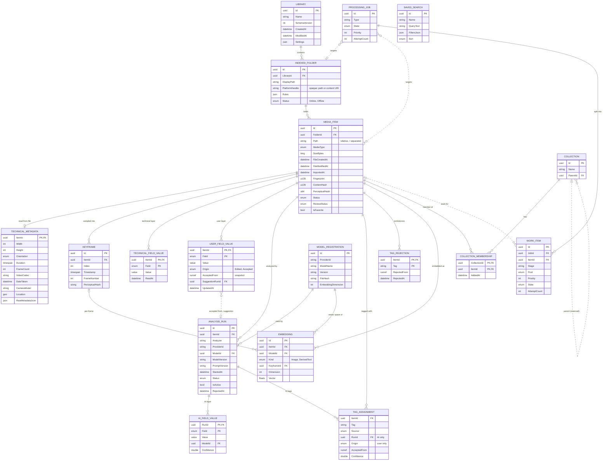

# Domain model

The entities and rules the whole application uses (E01-S02). They live in `src/MediaFileClassifier.Domain`, which references no storage engine and no platform API, so the Android app reuses them (D028, D062).

Each library is its own database (`<name>.mfc/library.db`, E01-S03), so every entity except `Library` lives inside exactly one library.

## Identity

Every entity ID is a UUIDv7 created with `Guid.CreateVersion7()`, wrapped in `Id<TEntity>` so IDs of different entities can't be mixed up (D066).

- **Globally unique and device-independent:** libraries exported from different devices merge without key collisions (D004). Auto-increment integers would collide.
- **Time-sortable:** new rows append to B-tree indexes, which keeps inserts cheap.
- **No extra dependency.**

Some records are keyed by what they belong to instead of their own ID: a user value by item and field, an AI value by run and field, a tag rejection by item and tag, and a collection membership by collection and item.

## ER diagram



## Entities

Invariants are enforced in the constructors and methods, so an invalid entity can't be created or loaded.

| Entity | What it is | Invariants |
|--------|-----------|------------|
| `Library` | A searchable index of folders, with its schema version and per-library settings (`LibrarySettings`: auto-analysis, previous runs to keep, active search model). | Name not blank; schema version ≥ 1; modified ≥ created. |
| `IndexedFolder` | A root folder. `PlatformHandle` is opaque: a path on Windows, a content URI on Android (E01-S07). Include and exclude globs, and an online or offline status. | Handle and display path not blank. |
| `MediaItem` | One file: folder plus relative path, media type, size, file dates, import date, hashes (E01-S06), processing status with the failed stage and kind of failure while it's Error (`MediaItemError`, E03-S07), review status (D021), favorite flag, and when the review status and favorite flag last changed (null if never; for package merges, D076). | Size ≥ 0; status changes follow the table below; `RelativePath` is relative, `/`-separated, with no empty, `.` or `..` segment. |
| `TechnicalMetadata` | Facts read from the file: dimensions, orientation, duration, frame count, loop count, frame rate, codecs, whether a video has audio, bit rate, color space, date taken with its offset and its source (EXIF, video creation time or file modification time), camera, lens, GPS, the full raw dump as JSON, and the warnings of a partial read (E03-S03). One per item. | Coordinates in range. |
| `Keyframe` | A frame sampled from a video or animated image (E06-S02): its index among the item's keyframes, its timestamp (for animated images, the sum of the preceding frame delays), the frame number when known, and the frame's perceptual hash. Re-sampling replaces all of an item's keyframes, which deletes their per-frame embeddings. Frame thumbnails for the timeline are files next to the item's thumbnails, written by E14, with no column. | Index and timestamp ≥ 0; indexes unique per item. |
| `TechnicalFieldValue` | A descriptive value found in the file, such as an embedded title. | Value kind fits the field; never `Notes`. |
| `AiFieldValue` | A descriptive value produced by a run, with its model and optional confidence. Belongs to the run. | Value kind fits the field; never `Notes`; confidence in 0–1. |
| `UserFieldValue` | A user-owned value, with its origin (`Edited` or `Accepted`) and, if accepted, a `RunReference` snapshot of the run (model, prompt version, date). Can carry a new-AI-suggestion flag. | Accepted ⇔ has a run reference. |
| `TagAssignment` | One tag on one item, with its source. AI assignments belong to a run; user assignments record their origin. | Provenance fits the source. |
| `TagRejection` | Tombstone of a tag the user removed. AI and technical assignments of that tag are ignored. | One per item and tag. |
| `AnalysisRun` | One execution of one analyzer on one item: analyzer, provider, model, model version, prompt version, dates, status, active flag, rejection date. | Only a completed run can be active or rejected; a finished run has a completion date; at most one active run per item and analyzer. |
| `ModelRegistration` | An AI model the library used: provider, name, version or file hash, embedding dimension (E01-S05). Immutable. | Provider and name not blank; dimension > 0 if set. |
| `Embedding` | A vector of an item, or of one keyframe, from one model. Several per item are allowed. **Vectors from different models are never compared.** | Dimension > 0 and equals the vector length; values finite; created only from an embedding model. |
| `Collection`, `CollectionMembership` | A flat list of items; `ParentId` is reserved for nesting (D023). | Name not blank; not its own parent. |
| `SavedSearch` | Query text, filters as JSON, and sort order. Later; shape reserved. | — |
| `ProcessingJob` | Job record: type, description, target (library, folder or items), state, priority, attempts, last error, dates. Behaviour is E05. | — |

`ItemMetadata` isn't stored on its own: it gathers one item's technical, user and AI values, tags, tombstones and retained runs, and applies the rules below.

### Media item status

```
Discovered → Pending | Error | Missing | Excluded
Pending    → Indexed | Error | Missing | Excluded
Indexed    → Pending | Error | Missing | Excluded   (Pending: file changed or re-index requested)
Error      → Pending | Missing | Excluded            (Pending: retry)
Missing    → Pending | Indexed | Excluded            (Indexed: file found again unchanged)
Excluded   → Pending | Missing                       (Pending: rule removed or item restored)
```

Nothing returns to `Discovered`. Missing and excluded items keep their metadata, user values and collection memberships, so a restore loses nothing (E02-S10, D024).

## Effective values and re-analysis

**Effective value rule:** User, then AI, then Technical (spec 1.5). The AI layer is the values of each analyzer's active run, unless the run was rejected in review (D021). If two analyzers produce the same field, the newer run wins. `ResolvedField` and `ResolvedTag` return the winning value with its provenance.

**Descriptive fields:** title, description, summary, notes (user-only), OCR text and transcript are text fields. Objects, scenes, actions, emotions and people are list fields. An empty user value is valid: it means the user cleared the field, and it hides the AI value.

| Situation | What happens |
|-----------|--------------|
| A new run completes | It becomes the analyzer's active run. The previous active run is kept for comparison; older ones are pruned with their values and tags. |
| The field has no user value | The new AI value becomes effective automatically. |
| The field has a user value (Edited or Accepted) | The user value stays. The user value is flagged with a **new AI suggestion** (the run ID) only if the new AI value differs from the user value **and** from the analyzer's previous run's value, or if it was flagged already and not dealt with. A value the user dismissed therefore stays dismissed until a run gives a different one. |
| The user accepts the suggestion | The user value becomes the new AI value, Accepted from the new run. |
| The user dismisses the suggestion | The user value stays and the flag is cleared. Runs that give the same value as the previous run don't flag it again. |
| The user removes a tag (`RemoveTag`) | Only the user's assignment goes, with no tombstone: if an AI run or the file gives the tag too, it shows again as an AI or file tag. |
| The user rejects a tag | A tombstone is kept. Neither the file nor any later run brings the tag back. Adding the tag manually removes the tombstone. |
| The user accepts a tag | It becomes a user tag, Accepted from its run. It stays when later runs drop it. |
| The user rejects a run in review (D021) | Its AI values and tags stop being effective. User values and embeddings stay. |
| Review "Accept" | Every effective AI value and tag becomes user-owned, Accepted. |
| A run with an accepted value's origin is pruned | The value keeps its `RunReference` snapshot (run ID, analyzer, model, prompt version, date). |
| A suggesting run is pruned | The suggestion flag is cleared. |

`ApplyRun` also reports whether any effective value or tag changed, so the item can go back to Unreviewed (D021). Embeddings aren't versioned per run: model changes are handled by keeping embeddings of both models and switching the library's active search model (E06-S07-T05).

The unit tests in `tests/MediaFileClassifier.Domain.Tests/Metadata/ItemMetadataTests.cs` and `Analysis/AnalysisRunRetentionTests.cs` cover each row.

## Filters and sorting (spec 1.7)

| Filter or sort | Field |
|----------------|-------|
| Media type | `MediaItem.MediaType` |
| File format | `MediaItem.FileFormat` (extension); `TechnicalMetadata.ContainerFormat` and `MimeType` for the detected format |
| Date | `TechnicalMetadata.DateTaken` (with `DateTakenOffset`), falling back to `MediaItem.FileModifiedAt` or `FileCreatedAt` |
| Resolution | `TechnicalMetadata.Width`, `Height`, `DisplayWidth`, `DisplayHeight`, `PixelCount` |
| Collection | `CollectionMembership` |
| Favorite status | `MediaItem.IsFavorite` |
| Processing status | `MediaItem.Status`, plus `AnalysisRun.Status` per analyzer |
| User tags | `TagAssignment` with source User |
| Sort: relevance, name, date, size, import date | search score, `MediaItem.FileName`, date as above, `MediaItem.SizeBytes`, `MediaItem.ImportedAt` |

Extended filters (E10-S05) can use duration, camera, location and codecs, which are typed properties, or the raw JSON.

## Epic check

| Epic | Supported by | Not modeled yet |
|------|--------------|-----------------|
| E01 Foundation | IDs (D066), all entities, hashes (S06), opaque folder handle (S07), model registration (S05) | — |
| E02 Library management | `Library`, `IndexedFolder` (add, remove, relink, offline), statuses for statistics, `Excluded` items keep user values (S10) | Backup is a file operation |
| E03 Media ingestion | `MediaItem.Discover`, `TechnicalMetadata`, fingerprint at discovery | Thumbnails are cache files, not entities |
| E04 Folder monitoring | `Relocate` keeps identity on move or rename, `Missing` status, folder online or offline | — |
| E05 Background processing | `ProcessingJob` and `WorkItem` (one stage for one item), their states and transitions, priorities and resource pools (E05-S01) | Pause (S05, Later) |
| E06 AI analysis | `AnalysisRun`, `AiFieldValue`, AI tags, `Embedding` per model and keyframe, `Keyframe`, active search model | Per-frame OCR results (E06-S02) are stored as item-level OCR text for now; faces and person clusters (S10, Later) |
| E07 Metadata management | Three layers, user origins, tag assignments and tombstones, provenance for display (S11) | Custom fields (S06) and edit history (S07) are Later and need their own tables |
| E08 Review workflow | `ReviewStatus`, `AcceptAll`, `RejectActiveRun`, suggestion flag, previous runs for comparison (S06) | — |
| E09 Search | Effective values and tags for text search, embeddings for similarity, `SavedSearch` (S09) | Search history (S08, Later) |
| E10 Filtering and sorting | See the table above | — |
| E11 Collections and favorites | `IsFavorite`, `Collection` with reserved `ParentId`, `CollectionMembership` | — |
| E12 Duplicate detection | Fingerprint, content hash and perceptual hash on `MediaItem` | Duplicate groups and ignored pairs (S03, S04, Later) |
| E13 App shell | No domain data | — |
| E14 Media browser and preview | Item fields, `Keyframe` timestamps, offline and missing status (S07) | — |
| E15 Dashboard and notifications | Counts come from item and job states | Notification history and activity log (S02, S04, Later) |
| E16 Accessibility and shortcuts | No domain data | — |
| E17 Settings | `LibrarySettings` for per-library settings; app settings live in `Infrastructure.Abstractions` | — |
| E18 Extensibility | Analyzers, providers and models are keys and registrations, not enums, so plugins can add them | — |
| E19 Packaging and distribution | No domain data | — |
| E20 Android app | Opaque folder handle, relative paths, UUIDv7 IDs and content hashes for matching phone files to an imported library | Sync-back merge rules (S08) |

## Storage cost of a previous run

D020 keeps one previous analysis run per item and analyzer by default (`LibrarySettings.RetainedPreviousRuns`). This estimates what that costs for a 100k-item library.

A previous run holds the same kind of data as the active run, so it costs about as much as the active AI layer.

**Assumptions** (per item, SQLite):

- Each stored row costs about 110 bytes besides its text: run ID, item ID and model ID (16 bytes each), field, confidence and date, the record header, and one secondary-index entry.
- The caption analyzer writes 8 fields: title (60 B), description (400 B), summary (150 B), and five short lists (objects, scenes, actions, emotions, people: 300 B together).
- A quarter of the items have OCR text (400 B on average), and a tenth are videos with a transcript (3 KB on average).
- An item gets about 15 AI tags of about 12 bytes each.

| Part | Rows per item | Bytes per item |
|------|---------------|----------------|
| Run rows (caption, plus OCR and transcript where they apply) | ~2 | ~350 |
| Caption field values | 8 | ~1,800 |
| OCR text | 0.25 | ~130 |
| Transcript | 0.1 | ~310 |
| AI tag assignments | 15 | ~1,800 |
| **Total** | | **~4.4 KB** |

**Estimate:** about **0.45 GB** for 100k items, in a range from about 0.2 GB (short descriptions, few tags) to about 0.8 GB (many videos with long transcripts).

For comparison, at 100k items the active AI layer is also about 0.45 GB, 512-dimension float embeddings are about 0.2 GB, and thumbnails at about 20 KB each are about 2 GB. Keeping one previous run adds roughly 15–20% to a typical library.

**Conclusion:** the default of one previous run is affordable. If it turns out too large, the persistence layer (E01-S03) can:

- leave the model ID out of value rows, since the run already records it (about 0.35 KB per item),
- store a previous run's values and tags as one compact JSON row per run, instead of a row each,
- leave previous runs out of the full-text index, since search uses only effective values.

Users can also set the retention to 0.
