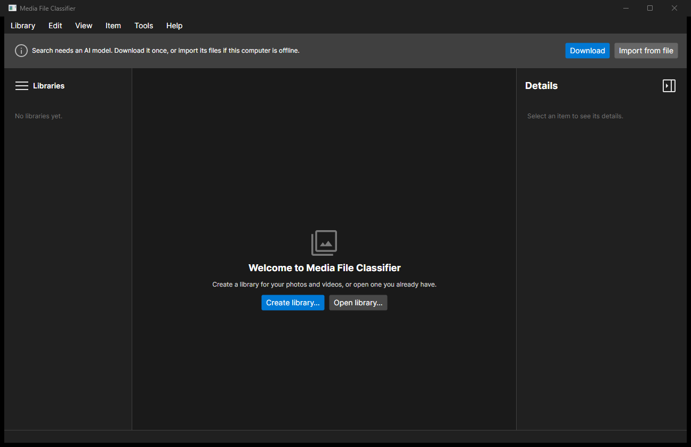
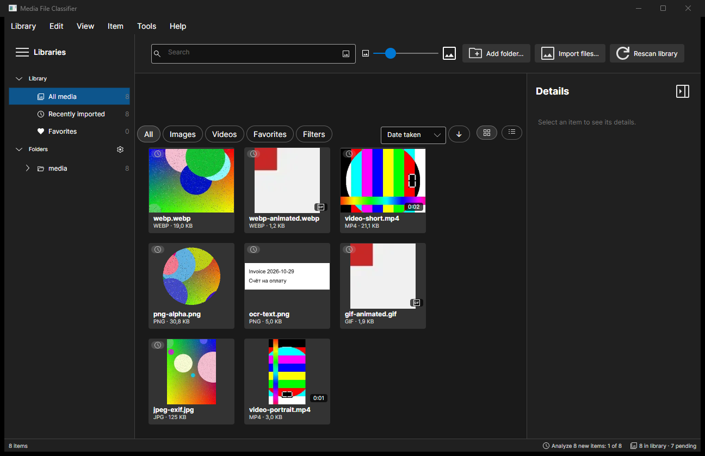
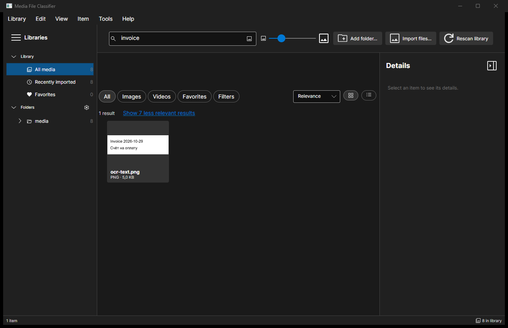
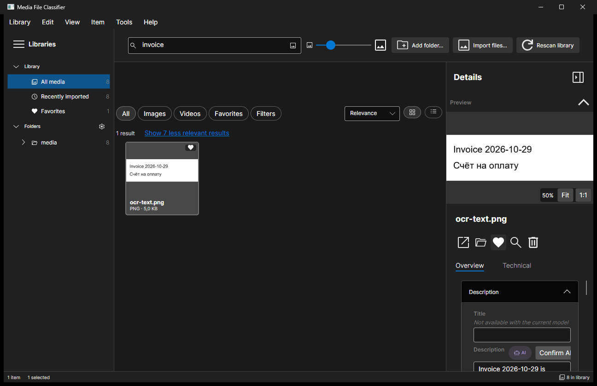
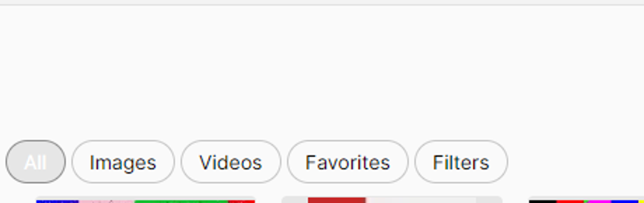

# 1.0.0 end-to-end pass (MFC-1024)

Run on 2026-11-22 against commit `8c2b610` (develop) plus the `--data-dir` option added here.

**How.** Release: `dotnet publish src/MediaFileClassifier.Desktop -c Release -r win-x64`, run with `--data-dir <throwaway folder>` (new, see below), never on `%LOCALAPPDATA%\MediaFileClassifier`. The library was made by a Debug smoke run from `tests/SampleMedia` (8 items) and copied into the throwaway folder; the three models (3.4 GB) were copied from the developer's models folder, not downloaded. Debug: all 22 scripts in `tools/ui-smoke` (exit code 0 for every one).

**Limits of this pass.** Release has no scripting tool, and the pass had no mouse and keyboard automation it could use safely, so Release was checked by hand-built screenshots, the database and the log. Flows marked *Debug* ran only in the smoke tool. A native folder or file picker cannot be scripted in either build.

| Flow | Build | Result | Notes |
|---|---|---|---|
| Publish | Release | OK, with a Bug | 147 files, 260 MB; 110 MB of .pdb files, XML docs and `onnxruntime.lib` shipped: MFC-1030. |
| Native libraries | Release | OK | The log shows SkiaSharp, LibVLC 3.0.24 (`libvlc` folder next to the exe) and FFmpeg found; ONNX Runtime with DirectML loaded the models on the GPU (SigLIP 2, PP-OCRv5) and on the CPU (Florence-2); SQLite (`e_sqlite3.dll`) opened the library. No missing DLL. FFmpeg is not bundled (D033): it was found on `PATH` (chocolatey) here; a machine without it gets file-level metadata only, by design. |
| First run, empty state | Release | OK | Welcome view, "Search needs an AI model" bar with Download and Import from file. Log clean (no warning or error).  |
| Corrupt `settings.json` | Release | OK | A bad file was kept as `settings.json.corrupt`, defaults used, one warning logged. |
| Embedding model download | not run | skipped | About 3.4 GB (SigLIP 2 2.3 GB, Florence-2 1.1 GB, OCR 13 MB); the user chose import instead. The real download path is **unchecked**. |
| Model import from a folder (D496) | not run on the UI | partly | The picker is native. The models were placed in the data folder's `models` directory as an import leaves them, and the app used them. The import dialog itself is **unchecked** (covered by unit tests only). |
| Create library, add folders, import with progress and notifications | Debug | OK | `sample`, `import-files`, `drag-drop-import`, `notifications`. Create library on Release needs the native picker: **unchecked on Release**. |
| Open an existing library | Release | OK | Opened from `lastLibraryPath`, 8 items with thumbnails, durations and animated badges. |
| Analysis without a model server | Release | OK | No endpoint is configured in a fresh data folder, so Florence-2 (CPU) described, SigLIP 2 and PP-OCRv5 ran. All 8 items finished. 8 tiny items took about 5 minutes including about 40 s of model loading.  |
| Analysis with a local model server | not run | **unchecked** | LM Studio was running on `localhost:1234`, but adding an endpoint needs the settings UI, which was not driven. |
| Text search | Release | OK | "invoice" finds `ocr-text.png` through OCR; "Show 7 less relevant results" link.  |
| Find similar | not run | **unchecked** | |
| Details panel, favorite, undo | Release | OK | Favorite on: sidebar count 1; Ctrl+Z restored 0 (checked in the database). "Confirm AI" is clipped: MFC-1029.  |
| Edit fields, bulk edit | not run | **unchecked** | No smoke script covers them. |
| List and grid views | Debug | OK | `list-view`, `list-header`, `show-file-names`, `responsive`, `minimum-width`. |
| Layout problems seen | Release and Debug | 3 Bugs | Empty band under the toolbar: MFC-1027. Light theme chip contrast: MFC-1028 . |
| Offline drive | Debug | OK | `offline-items` (unplug, plug back). |
| Rescan, remove missing, remove items | Debug | OK | `library-maintenance`, `remove-items`. |
| Compact database (D502) | Debug | OK | `compact-database`. |
| Delete library | Debug | OK | `delete-library`. |
| Keyboard-only use | Debug | OK | `default-shortcuts`, `keyboard-focus`, `keyboard-dialogs`, `keyboard-popups`. Not repeated on Release. |
| Restart with a running job | Release | OK | The app was killed during analysis; on start the log said "6 work items pending, 1 put back after an interruption" and analysis finished. |
| Log contents | Release | OK | Clean runs: only Information lines, no error or warning (the one warning came from the deliberately corrupt settings file). No line is written at shutdown. |
| App version | Release | note | The log says `0.1.0`; MFC-1023 owns versioning. |

## Added in this PR

`--data-dir <folder>` now works in every build (it was Debug smoke only), so a published build can run on a throwaway data folder. See `docs/testing.md`.

## Bugs filed (fix version 1.0.0)

| Key | Severity | Problem |
|---|---|---|
| MFC-1027 | Low, UI | Empty band of about 90 px between the toolbar and the filter chips. |
| MFC-1028 | Medium, UI | Light theme: the selected "All" chip is white text on light grey. |
| MFC-1029 | Low, UI | Details panel: "Confirm AI" button clipped at the default width. |
| MFC-1030 | Low | Release publish ships .pdb, .xml and .lib files (110 MB of 260 MB). |
